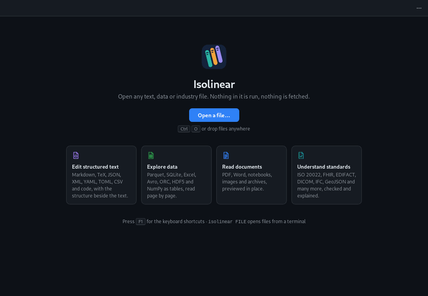

# Isolinear

**Open any text, data or industry file. Edit the structured ones. Nothing runs, nothing is fetched.**



## What it does

- **Edit structured text**: Markdown with live preview, TeX, BibTeX, JSON, XML, YAML, TOML, CSV and
  source code, with the structure beside the text. Saving keeps encoding and line endings.
- **Explore data**: Parquet, SQLite, Excel, Avro, ORC, HDF5 and NumPy as tables you can sort and filter.
- **Read documents**: PDF, Word, Jupyter notebooks, images and archives, previewed in place.
- **Understand industry files**: ISO 20022, FHIR, EDIFACT, DICOM, IFC, GeoJSON and many more, with what
  was checked and each fact linked to its place in the file.

Every other file still opens, as a summary, its readable strings and its bytes.
[FORMATS.md](FORMATS.md) has the full list.

## Install

Download the package for your system from [Releases](https://github.com/mlaib/isolinear/releases):
`.deb` or `.AppImage` (Linux), `.dmg` (macOS), `.msi` (Windows).

## Use

```sh
isolinear report.parquet notes.md   # each file in a window of its own
```

Files open read-only; press **Ctrl+E** (Cmd+E) to edit and **F1** for every shortcut.

Quick preview from your file manager:

| System | How |
|---|---|
| macOS | Space in Finder (built in) |
| Linux (GNOME Files) | `isolinear --enable-file-manager-preview`, then Space |
| Windows (Explorer) | `isolinear --enable-file-manager-preview`, then the preview pane (Alt+P) |

`--disable-file-manager-preview` turns it off again.

## Safe by design

A file is only read. Scripts, macros, formulas, SQL, notebook code and links are never run or followed,
and the app makes no network connection; a test in CI checks it. See [SECURITY.md](SECURITY.md).

## Build from source

Rust 1.92, Node 22 and the [Tauri 2 prerequisites](https://v2.tauri.app/start/prerequisites/).

```sh
npm ci
npm run tauri dev      # run the app
npm run tauri build    # packages in target/release/bundle
```

Contributions are welcome: see [CONTRIBUTING.md](CONTRIBUTING.md).

## Credits

Built by [mlaib](https://github.com/mlaib) with [Claude](https://claude.ai) (Anthropic) as co-author.
Licensed under [Apache-2.0](LICENSE).
